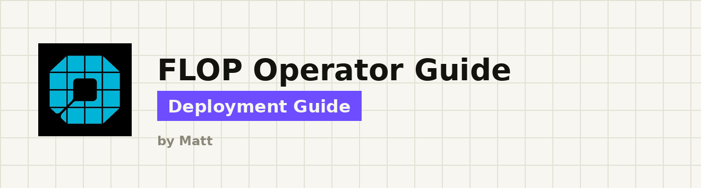

<div align="center">

# FLOP Operator Guide

**Devnet validator + GPU miner setup — practice for testnet. Nothing earns here.**

<a href="https://x.com/mattdreams"></a>

</div>

---

> **⚠️ PLEASE TAKE NOTE**
>
> **The FLOP Devnet is disposable and earns nothing.** No rewards. No airdrop weight. Run it for the tech, or to be ready when testnet opens.
>
> There is **no FLOP token** yet. Only trust links on the [official links page](https://docs.flop.network/docs/official-links).

---

## Table of Contents

- [What is this?](#-what-is-this-)
- [Prerequisites](#-prerequisites-)
- [Quick Start](#-quick-start-)
- [Specs](#-specs-)
- [Network](#-network-)
- [Validator](#-validator-)
- [GPU Miner](#-gpu-miner-)
- [Troubleshooting](#-troubleshooting-)
- [Official links](#-official-links-)
- [Disclaimer](#-disclaimer-)

---

<h2 align="center">⭐ What is this? ⭐</h2>

A community operator guide for **FLOP Labs** on the current **devnet**:

| Role | What you run | GPU? | Success looks like |
| --- | --- | --- | --- |
| **Validator** | CPU node (BABE blocks + AlephBFT finality) + DA worker | No | Active session / BABE / Aleph keys + advancing finality |
| **GPU Miner** | `miner-vllm-toploc` backend + `miner-worker` | Yes (NVIDIA) | Inference → registration → accepted calibration (paid work is a later gate) |

**Status (as of 6 Nov 2026):**

- **Validators:** still **administrator-assisted**. Package `validator-cs-be91fe83 · 0.3.0-devnet.1` is live. Self-service public testnet onboarding is **not open**.
- **Miners:** from **~2 Nov 2026** you can join **without an invite** via the public miner pack (auto-sponsor with caps). Paid sessions / full public gateway admission are still finishing — see official miner docs.
- This README is a curated walkthrough. Prefer [docs.flop.network/operators](https://docs.flop.network/operators) when anything conflicts.

Inspired lightly by community FLOP write-ups and structured like a Boundless-style ops README. Branding and layout by Matt.

---

<h2 align="center">📋 Prerequisites 📋</h2>

### Notes

- **Never share** your seed phrase, keystore password, or session token — not with “support”, DMs, or an AI agent. FLOP never asks for your seed.
- **Do not** use the same account for a validator and a miner. Create a dedicated sr25519 miner account.
- **Never** run two validators with the same session keys (simultaneous voting = equivocation).
- Do **not** invent hostnames, image digests, model hashes, or peer multiaddrs. Missing input = blocked step.
- Stopping Docker Compose **does not** stop VM billing. Delete the instance in your provider console when done.

### Requirements

**Both roles**

- [ ] Linux amd64 host (Ubuntu recommended; miner installer pack targets Ubuntu 24.04)
- [ ] Docker Engine + Docker Compose v2
- [ ] `curl`, `jq`
- [ ] Read [Operator hub](https://docs.flop.network/operators)

**Validator only**

- [ ] Node.js **24**, **pnpm 12.14.0**, `age`
- [ ] Ops contact (or request intro via [flop-labs/network#10](https://github.com/flop-labs/network/issues/10))
- [ ] Download + SHA-256 verify the live validator package (below)

**GPU miner only**

- [ ] NVIDIA GPU (A40 validated for the current drill)
- [ ] Full VM / owned host with NVIDIA driver + Container Toolkit (container-only rentals often cannot run Compose)
- [ ] Public DNS name with ports **80/443** open (or your own tunnel to `127.0.0.1:8645`)
- [ ] Public miner pack (below) — no invitation required for auto-sponsored join within caps

---

<h2 align="center">🏃 Quick Start 🏃</h2>

### Path A — Validator (manual, ops-assisted)

1. Install Docker, Node 24, pnpm 12.14.0, age
2. Download & verify `validator-cs-be91fe83-0.3.0-devnet.1`
3. Set a stable hostname → `pnpm onboard prepare`
4. Send **hostname + public SS58 + host SSH pubkey** to ops
5. Wait for Tailscale enrollment, funding, `da-peers.json`, access checks
6. `pnpm onboard join` → tell ops **ready** → after activation `pnpm onboard verify`

Details: [Validator](#-validator-)

### Path B — GPU Miner (public pack)

1. Rent / prepare an NVIDIA VM with Docker + NVIDIA toolkit + public DNS
2. Download & verify the public miner pack
3. Follow the pack `README.md`: create account → `./sponsor.sh` → `./decode-policy.sh` → Compose up
4. Confirm registration / calibration evidence; do **not** claim paid earnings on current devnet

Details: [GPU Miner](#-gpu-miner-)

### Automated vs Manual

| Role | Automated | Manual |
| --- | --- | --- |
| Validator | Optional agent skill `setup-validator` ([ask.flop.finance/reference](https://ask.flop.finance/reference)) — still needs ops admission | This guide + package README |
| Miner | Optional skill `flop-miner-devnet` + pack README; one-command `install.sh` **not published yet** | Public pack scripts (`sponsor.sh`, `decode-policy.sh`, Compose) |

---

<h2 align="center">🖥 Specs 🖥</h2>

### Validator

| Resource | Planning profile |
| --- | --- |
| CPU | 8 dedicated cores |
| RAM | 32 GB |
| Storage | 4 TB NVMe (DA custody drives size) |
| Network | Reliable low-latency ~1 Gbps |

These are FLOP planning estimates, not measured hard minimums.

### GPU Miner

| Resource | Notes |
| --- | --- |
| GPU | NVIDIA; **A40** validated (Qwen2.5-0.5B-Instruct, BF16) |
| Host | Full VM or owned Linux with Docker, Compose, NVIDIA driver + Container Toolkit |
| Storage | Checkpoint + volumes (~60 GB for Qwen2.5-0.5B on typical rentals) |
| Network | Public DNS; ports **80/443** (or tunnel to loopback session port) |

Faster GPUs → larger capacity-stake requirement. Container-only products (e.g. some RunPod Pods) cannot run the Compose pair on one host — see official [Run a miner](https://docs.flop.network/docs/run-miner) for split-host patterns.

---

<h2 align="center">🌐 Network 🌐</h2>

### Public endpoints

| Setting | Value |
| --- | --- |
| RPC | `wss://rpc.devnet.flop.network` |
| Ghost mailbox | `https://mailbox.devnet.flop.network` |
| Faucet / stake sponsor | `https://faucet.flop.network` |
| Explorer | `https://explorer.devnet.flop.network` |
| Releases manifest | `https://flop.network/releases.json` |

### Devnet identity (validators)

| Field | Value |
| --- | --- |
| Raw spec ID | `flop_devnet_ts` |
| Protocol ID | `flop-devnet-ts` |
| Genesis | `0x99c172c095340ace980631f9123544c6bebd4839f3437e463533422d8be2d631` |

A file SHA-256 and a genesis hash are different values — do not compare them to each other.

### Devnet miner limits (official)

| Limit | Value |
| --- | --- |
| New sponsored miners | at most **100** / rolling 24h |
| Sponsored stake | at most **200M** FLOP / rolling 24h (new ~1M; top-ups ≤ ~2M) |
| Sponsorships per account | **one** |
| Public sponsor route | **6 req/min** per address |
| Auto-sponsor uncalibrated cap | **40** (from ~2 Nov 2026); `429` when full → retry after someone calibrates |

Live budgets: `GET https://faucet.flop.network/limits`

---

<h2 align="center">🏅 Validator 🏅</h2>

Official manual: [Run a validator](https://docs.flop.network/docs/run-validator)

Package (live): **`validator-cs-be91fe83 · 0.3.0-devnet.1`** · Linux amd64

| Artifact | URL |
| --- | --- |
| Archive | https://explorer.devnet.flop.network/validator-downloads/validator-cs-be91fe83-0.3.0-devnet.1.tar.gz |
| Checksum file | https://explorer.devnet.flop.network/validator-downloads/validator-cs-be91fe83-0.3.0-devnet.1.tar.gz.sha256 |
| Archive SHA-256 | `bf98e281b7d3217fb52e9aeba75886d2165e66d32f0159dbc3f1f2e998e30ba7` |

### 1 — Install essentials

```bash
sudo apt update && sudo apt upgrade -y
sudo apt install -y curl jq ca-certificates gnupg lsb-release age

# Docker (Ubuntu) — follow Docker's official apt repo steps, then:
sudo apt update
sudo apt install -y docker-ce docker-ce-cli containerd.io docker-buildx-plugin docker-compose-plugin
docker --version
docker compose version

# Node 24 + pnpm 12.14.0
curl -fsSL https://deb.nodesource.com/setup_24.x | sudo -E bash -
sudo apt-get install -y nodejs
sudo corepack enable
sudo corepack prepare pnpm@12.14.0 --activate
node -v    # expect v24.x
pnpm -v    # expect 12.14.0
age --version
```

### 2 — Download, verify, extract

```bash
mkdir -p ~/flop && cd ~/flop
wget https://explorer.devnet.flop.network/validator-downloads/validator-cs-be91fe83-0.3.0-devnet.1.tar.gz
wget https://explorer.devnet.flop.network/validator-downloads/validator-cs-be91fe83-0.3.0-devnet.1.tar.gz.sha256
sha256sum -c validator-cs-be91fe83-0.3.0-devnet.1.tar.gz.sha256
# or pin explicitly:
echo "bf98e281b7d3217fb52e9aeba75886d2165e66d32f0159dbc3f1f2e998e30ba7  validator-cs-be91fe83-0.3.0-devnet.1.tar.gz" | sha256sum -c -
tar -xzf validator-cs-be91fe83-0.3.0-devnet.1.tar.gz
cd validator-cs-be91fe83 && cat README.md
```

`OK` = safe to continue. `FAILED` = delete and re-download.

### 3 — Hostname, then prepare

`prepare` uses the **current** hostname (often a provider default). Set something stable **before** prepare. Do **not** rename after ops enrolls you.

```bash
sudo hostnamectl set-hostname your-stable-name
# new shell / reconnect SSH, then:
hostname -f 2>/dev/null || hostname

node preflight.mjs
pnpm install --frozen-lockfile --ignore-scripts
pnpm onboard prepare
# default profile: administrator-assisted-devnet
```

`prepare` prints public hostname + SS58 and writes private `account.json` / `.env` (mode `600`) locally.

### 4 — Public values for ops

Also collect the host SSH **public** key (ops encrypts Tailscale enrollment to it):

```bash
mkdir -p ~/flop
PUBLIC_NOTE=~/flop/ops-public-values.txt

{
  echo "Hostname: $(hostname -f 2>/dev/null || hostname)"
  echo "Public SS58 address: $(jq -r '.address // .ss58Address // .publicAddress // empty' account.json 2>/dev/null || true)"
  echo "Host SSH public key:"
  cat /etc/ssh/ssh_host_ed25519_key.pub
  echo
  echo "Host SSH fingerprint (confirm on a second channel):"
  ssh-keygen -lf /etc/ssh/ssh_host_ed25519_key.pub
} | tee "$PUBLIC_NOTE"

chmod 644 "$PUBLIC_NOTE"
cat "$PUBLIC_NOTE"
```

Send **only**:

1. Hostname  
2. Public SS58 address  
3. Host SSH public key (`/etc/ssh/ssh_host_ed25519_key.pub`)

Confirm the `SHA256:` fingerprint on a **second channel**.

**Never send:** seed, `account.json`, `.env`, node keystore, private SSH keys.

Who: the FLOP team member already coordinating your invite. No contact yet? Request an introduction in [flop-labs/network#10](https://github.com/flop-labs/network/issues/10). An issue alone does **not** grant admission.

### Ports (0.3.0 package)

| Port | Use | Exposure |
| --- | --- | --- |
| `30333` TCP | P2P | tailnet |
| `7001` TCP | DA (host; maps to container 7000) | tailnet |
| `9944` | RPC | **loopback only** |
| `9615` | metrics | **loopback only** |

### 5 — Wait, then join

**Do not** run `pnpm onboard join` / `verify` right after prepare.

Wait until ops has given you **all** of:

1. **Tailscale enrollment** (encrypted key / `tailscale up` for your hostname; leave Tailscale SSH off: `sudo tailscale set --ssh=false`)
2. **Funding** above the live stake floor
3. **`da-peers.json`** beside the package README (join refuses missing / empty / non-tailnet peers)
4. **Access-check confirmation** (unintended services blocked; P2P/DA peers reachable)

Then:

```bash
pnpm onboard join
```

Tell operations **ready**. Registration locks stake. If a submission fails or is partial — **STOP** and contact ops. Do not blindly rerun signed actions.

### 6 — Verify (after ops activates you)

```bash
pnpm onboard verify
```

“Ready” ≠ “active”. You need babe/audi/alp0 session keys **and** advancing finality.

### Optional — check published genesis before signing

See official validator docs for the raw-spec download + genesis comparison against `https://faucet.flop.network/chain` and public RPC. Expected genesis is listed in [Network](#-network-) above.

Upgrades / rollbacks: [upgrade manual](https://docs.flop.network/docs/upgrade) — do **not** re-register or change genesis during an upgrade.

---

<h2 align="center">🎮 GPU Miner 🎮</h2>

Official manual: [Run a miner](https://docs.flop.network/docs/run-miner)

### Public pack (checked Nov 2026)

Base: https://flop.network/releases/cli/miner-pack-devnet-ts-20261106/

```bash
B=https://flop.network/releases/cli/miner-pack-devnet-ts-20261106
curl -fLO "$B/flop-miner-pack-devnet-ts-20261106.tar.gz"
curl -fLO "$B/README.md"
echo "35f222f748447a8aabdd015d94260d8facfd29305691c3cf7ed033cbb2b514b1  flop-miner-pack-devnet-ts-20261106.tar.gz" | sha256sum -c -
tar xzf flop-miner-pack-devnet-ts-20261106.tar.gz
cd flop-miner-pack-devnet-ts-20261106   # use the extracted directory name from the archive
cat README.md
```

Images (`cli`, `miner-worker`, `miner-vllm-toploc`) pull from **`ghcr.io/flop-labs/flop-core`**.

### High-level flow (follow the pack README for exact commands)

1. **Host** — NVIDIA visible to `nvidia-smi` and inside Docker (`docker run --rm --gpus all … nvidia-smi` with an approved CUDA image).
2. **Account** — dedicated sr25519 miner account; seed in a root-owned `0600` signer file on the host. Separate from any validator.
3. **Sponsor** — `./sponsor.sh` (or pack equivalent) posts a signed request to `https://faucet.flop.network/sponsor/miner`. Sponsorship **registers** the account — do not `miner register` first on a sponsored path.
4. **Decode policy** — leave policy fields empty, then `./decode-policy.sh <env-file>` so allowlisted JSON is filled from `releases.json` + chain.
5. **Compose** — configure env from the pack template (pinned image digests, `SESSION_PUBLIC_HOST`, secrets via files/env — never on argv), then bring up worker + backend (+ TLS sidecar if using public 80/443).
6. **Evidence** — measured inference, registration, accepted calibration. Paid sessions / public gateway admission may still be gated — check official docs before claiming work is live.

### What works today (devnet miners)

- Sponsorship, registration, calibration via public mailbox  
- **Paid sessions are not open yet** (per official miner page as of early Nov 2026)  
- Deep paths (Qwen3.8 controller upgrade, RunPod split-host, multi-miner grants): **use official docs / pack README** — this guide does not invent those steps

### Agent-assisted (optional)

Public skill: https://flop.network/skills/flop-miner-devnet/SKILL.md  

Keep seeds, keystore passwords, and `SESSION_AUTH_TOKEN` **on the host** — never paste them into chat.

---

<h2 align="center">🩺 Troubleshooting 🩺</h2>

| Symptom | Likely cause | What to do |
| --- | --- | --- |
| `sha256sum: FAILED` | Corrupt / wrong download | Delete archive; re-download; re-check |
| `pnpm onboard verify` loops `API-WS: disconnected` | Joined/verified too early | Wait for ops Tailscale + funding + `da-peers.json` + activation |
| Sponsor `403` | Not approved / wrong path | Validators need ops; miners use public sponsor route + pack |
| Sponsor `429` | Caps / uncalibrated auto-sponsor full / rate limit | Check `/limits`; retry after calibrate or next day; do not loop |
| Sponsor `503` | Sponsor runtime not ready | Retry later; do not invent funding |
| Docker GPU missing | No toolkit / container-only rental | Use a full VM; verify `nvidia-smi` in container |
| Ports 80/443 unreachable | DNS / firewall / CGNAT | Fix DNS or use your own tunnel to `127.0.0.1:8645` |
| Partial `join` / signed failure | Chain / ops gate | **Stop** — contact ops; do not blindly rerun |

More: [ask.flop.finance](https://ask.flop.finance) · [flop-labs/network issues](https://github.com/flop-labs/network)

---

<h2 align="center">🔗 Official links 🔗</h2>

- Operator hub: https://docs.flop.network/operators  
- Run a validator: https://docs.flop.network/docs/run-validator  
- Run a miner: https://docs.flop.network/docs/run-miner  
- Official links (verify everything): https://docs.flop.network/docs/official-links  
- Docs assistant: https://ask.flop.finance  
- Access / intro: https://github.com/flop-labs/network/issues/10  
- Explorer: https://explorer.devnet.flop.network  
- FLOP on X: https://x.com/flop_labs  

---

<h2 align="center">📜 Disclaimer 📜</h2>

This is an **unofficial community guide** by Matt (@mattdreams / GitHub [0andadream](https://github.com/0andadream)).

- Devnet is disposable practice. **No earnings, no airdrop promises.**
- Commands and package pins change. Always cross-check [docs.flop.network](https://docs.flop.network/operators) and release checksums before signing or spending.
- You are responsible for your keys, host security, and cloud spend.
- MIT-licensed docs in this repo; FLOP protocol / images / packages remain their respective owners'.

---

<div align="center">

Built by [Matt](https://x.com/mattdreams) · GitHub [0andadream](https://github.com/0andadream) · MIT

</div>
